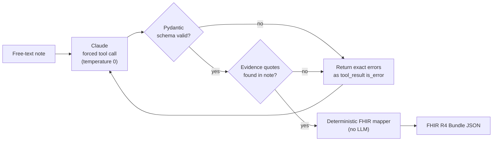

# 🩺 Struct — Unstructured Clinical Note → HL7 FHIR JSON Extractor

[](https://github.com/aj-elyoussef/struct-fhir-extractor/actions/workflows/ci.yml)


**Struct** converts messy, free-text physician progress notes into standardised **HL7 FHIR R4** JSON resources.
It uses **Claude's tool use** to force structured output, **Pydantic** to enforce a strict, deterministic schema,
and a **Streamlit** interface to compare the original note and the structured result side by side.

> ⚠️ **Portfolio / research demo.** Not a medical device and not for clinical use. All bundled notes are synthetic.

---

## ✨ What it extracts

| Clinical concept | Extracted fields | FHIR R4 resource |
|---|---|---|
| Patient demographics | name, gender, age, DOB, MRN | `Patient` |
| Symptoms (incl. negated, e.g. "denies chest pain") | name, present/absent, onset, severity | `Observation` (`valueBoolean`) |
| Diagnoses | name, verification status, ICD-10-CM code | `Condition` |
| Medications | drug, dose, route, frequency, duration, RxNorm | `MedicationRequest` |

All resources are returned in a single FHIR **transaction `Bundle`**, linked to the patient via `urn:uuid` references.

---

## 🧠 Why this is hard and how Struct solves it

LLMs are probabilistic, but health data pipelines need **deterministic, schema-valid** output. Struct layers several guards:



1. **Forced tool use.** The Pydantic schema is converted to JSON Schema and registered as the *only* tool; `tool_choice` forces Claude to call it, so free-text replies are impossible.
2. **Strict validation.** Enums (FHIR `AdministrativeGender`, `condition-ver-status`), regex-checked ICD-10-CM and RxNorm codes, numeric bounds, and `extra="forbid"` to reject invented fields.
3. **Evidence grounding.** Every symptom, diagnosis and medication must carry a verbatim `evidence` quote. A deterministic check confirms the quote appears in the note, catching hallucinated facts.
4. **Self-repair loop.** On any failure, the precise validation errors are returned to Claude as an `is_error` tool result, and it corrects itself (bounded retries, default 2).
5. **Deterministic FHIR mapping.** The validated object is mapped to FHIR in plain Python. Resource IDs are UUIDv5 values derived from a hash of the note, so the same input always produces the same Bundle.
6. **Prompt-injection hygiene.** The note is wrapped in `<clinical_note>` tags and treated as untrusted data.

---

## 🖥️ Streamlit interface

* Left: the original note. Right: the FHIR Bundle, entity tables, highlighted evidence and a validation report.
* Metrics: resource count, attempts, grounding warnings, tokens used.
* One-click **Download Bundle JSON**.
* **Demo mode** works with no API key, using saved extractions for the three synthetic sample notes.

<!-- After your first run, add a screenshot: save it as docs/screenshot.png and uncomment the next line -->
<!--  -->

---

## 🚀 Quick start

```bash
git clone https://github.com/aj-elyoussef/struct-fhir-extractor.git
cd struct-fhir-extractor
python -m venv .venv
source .venv/bin/activate        # Windows: .venv\Scripts\activate
pip install -r requirements.txt

cp .env.example .env             # then paste your Anthropic API key into .env
streamlit run app.py
```

No API key? Leave **Demo mode** on and pick a sample note.

### Command line

```bash
# Live extraction with Claude
PYTHONPATH=src python -m struct_fhir.cli examples/sample_notes/01_pneumonia.txt -o bundle.json

# Offline demo using a saved extraction
PYTHONPATH=src python -m struct_fhir.cli examples/sample_notes/01_pneumonia.txt \
    --demo examples/fixtures/01_pneumonia.json
```

### Python API

```python
from struct_fhir import ClinicalNoteExtractor

result = ClinicalNoteExtractor().extract(open("note.txt").read())
print(result.bundle)          # FHIR R4 transaction Bundle (dict)
print(result.extraction)      # validated Pydantic object
print(result.attempts, result.repair_log)
```

---

## 🧪 Tests

```bash
pip install -r requirements-dev.txt
pytest -v
```

24 tests run **without an API key** by using a fake Anthropic client. They cover schema rejection (bad enums, malformed codes, unknown fields), hallucination detection, the self-repair loop, retry exhaustion, FHIR reference integrity, deterministic output and refuted-diagnosis handling. GitHub Actions runs lint and tests on Python 3.10–3.12 for every push.

---

## 📁 Project structure

```
struct-fhir-extractor/
├── app.py                     # Streamlit side-by-side UI
├── src/struct_fhir/
│   ├── schemas.py             # Strict Pydantic extraction schema + grounding check
│   ├── extractor.py           # Claude tool use + validate-and-repair loop
│   ├── fhir_models.py         # Strict Pydantic models for FHIR R4 resources
│   ├── fhir_builder.py        # Deterministic extraction → FHIR Bundle mapper
│   └── cli.py                 # Command-line interface
├── examples/
│   ├── sample_notes/          # 3 synthetic physician notes
│   ├── fixtures/              # Saved extractions (demo mode + tests)
│   └── sample_output/         # Example FHIR Bundles
├── tests/                     # pytest suite (no network needed)
├── docs/architecture.md       # Design decisions and FHIR mapping
└── .github/workflows/ci.yml   # Lint + test on every push
```

---

## 🔍 Example output (excerpt)

```json
{
  "resourceType": "Condition",
  "clinicalStatus": {"coding": [{"system": "http://terminology.hl7.org/CodeSystem/condition-clinical", "code": "active"}]},
  "verificationStatus": {"coding": [{"system": "http://terminology.hl7.org/CodeSystem/condition-ver-status", "code": "confirmed"}]},
  "category": [{"coding": [{"system": "http://terminology.hl7.org/CodeSystem/condition-category", "code": "encounter-diagnosis"}]}],
  "code": {
    "coding": [{"system": "http://hl7.org/fhir/sid/icd-10-cm", "code": "J18.9", "display": "Community-acquired pneumonia, right lower lobe"}],
    "text": "Community-acquired pneumonia, right lower lobe"
  },
  "subject": {"reference": "urn:uuid:96c540e8-e387-5a88-8dd3-665c33306790"},
  "note": [{"text": "Source: \"Community-acquired pneumonia, RLL\""}]
}
```

Full bundles are in [`examples/sample_output/`](examples/sample_output/).

---

## 🛣️ Roadmap

- [ ] Terminology lookup against a FHIR terminology server to verify model-suggested codes
- [ ] `Encounter` and `AllergyIntolerance` resources
- [ ] Batch processing and evaluation metrics (precision/recall) on a labelled synthetic set
- [ ] Optional validation with the official HL7 FHIR Validator in CI

## 🛠️ Tech stack

Python · Anthropic SDK (Claude tool use) · Pydantic v2 · Streamlit · pandas · pytest · Ruff · GitHub Actions

## 👤 Author

**Ahmad Jamal El-Youssef** — AI Engineer

## 📄 License

MIT. See [LICENSE](LICENSE).
